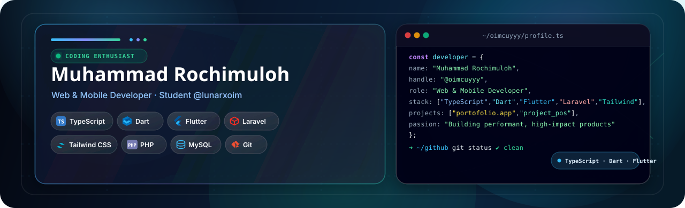
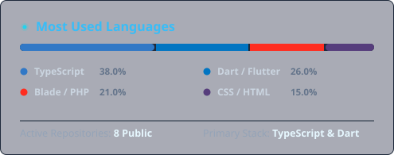
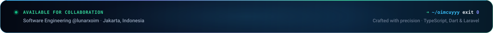

# 

<h3 align="center">
  
</h3>

  <b><i>"Passionate about crafting seamless web & mobile experiences, clean code architectures, and delightful interactive interfaces."</i></b>

  
  
  

---

###  Tech Ecosystem & Tooling

| Domain | Technologies & Tools |
| :--- | :--- |
|  **Languages** |       |
|  **Frameworks & Mobile** |     |
|  **Database & Architecture** |   |
|  **Development & Tools** |     |

---

###  Featured Projects

| Project | Focus & Description | Stack | Status |
| :--- | :--- | :--- | :--- |
| **[portofolio.app](https://github.com/oimcuyyy/portofolio.app)** | Personal digital portfolio showcase |  |  |
| **[project_pos](https://github.com/oimcuyyy/project_pos)** | Cross-platform Point of Sale (POS) system |   |  |
| **[presensi-magang-app](https://github.com/oimcuyyy/presensi-magang-app)** | Internship attendance management platform |   |  |
| **[portfolio-laravel](https://github.com/oimcuyyy/portfolio-laravel)** | Portfolio application powered by Laravel |   |  |
| **[project-kelompok](https://github.com/oimcuyyy/project-kelompok)** | Collaborative software engineering project |   |  |
| **[web-kelas-rpl](https://github.com/oimcuyyy/web-kelas-rpl)** | Class portal for Software Engineering students |   |  |

---

###  GitHub Activity & Statistics

<table align="center" style="border:none;">
  <tr style="border:none;">
    <td width="50%" align="center" style="border:none; padding:10px;">
      
    </td>
    <td width="50%" align="center" style="border:none; padding:10px;">
      
    </td>
  </tr>
</table>

  <picture>
    <source media="(prefers-color-scheme: dark)" srcset="https://raw.githubusercontent.com/oimcuyyy/oimcuyyy/output/galaga-contribution-graph-dark.svg" />
    <source media="(prefers-color-scheme: light)" srcset="https://raw.githubusercontent.com/oimcuyyy/oimcuyyy/output/galaga-contribution-graph.svg" />
    
  </picture>

---

  


